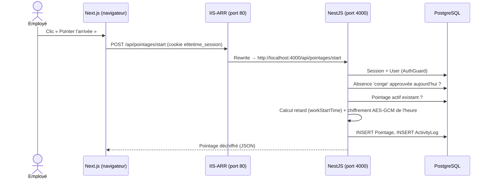

# 01 — Présentation fonctionnelle d'ELITE TIME

> Audit réalisé le 13/10/2026 sur le commit `e3878d4` (branche `main`) et sur le serveur `SVR-APP-PRD-01`.
> Légende des niveaux de preuve : **[Code]** vérifié dans le code · **[Env]** vérifié dans l'environnement · **[Doc]** documenté, non vérifié · **[À confirmer]** · **[Non implémenté]** · **[Partiel]** partiellement implémenté.

---

## 1. Synthèse pour la direction / le responsable informatique

ELITE TIME est l'application interne de **gestion des temps de présence** d'Elite Network. Elle remplace les feuilles de présence : chaque employé **pointe son arrivée et son départ** depuis un navigateur, les managers **suivent la présence de leur équipe**, **valident les congés**, et la direction reçoit des **rapports automatiques par e-mail** (quotidiens, hebdomadaires, mensuels).

| Question | Réponse courte |
|---|---|
| Problème résolu | Traçabilité des heures d'arrivée/départ, des retards, des absences et des congés ; production de rapports RH sans saisie manuelle. |
| Utilisateurs | Employés, chefs d'équipe (`team_lead`), managers, administrateurs. Comptes issus de l'Active Directory (logins commençant par `ut…`) plus quelques comptes locaux d'administration. |
| Accès | Navigateur web, réseau interne uniquement, via `http://elitetime.elitenetwork.local` (HTTP, sans HTTPS) **[Env]**. Application installable en PWA **[Code]**. |
| Hébergement | Une seule machine virtuelle Windows Server 2022 (VMware), 4 vCPU, 8 Go RAM, qui héberge aussi la base PostgreSQL 18 et le modèle d'IA local **[Env]**. |
| Systèmes externes | Active Directory (LDAP), Microsoft 365 via Microsoft Graph (envoi des e-mails), Ollama (IA locale) **[Code][Env]**. |
| État général | Fonctionnellement riche et en production. **Fragilités majeures** : pas de HTTPS, pas de sauvegarde de base vérifiable, démarrage dépendant d'une session utilisateur Windows, plusieurs failles de contrôle d'accès (voir `04` et `09`). |

**Points d'attention immédiats (constatés le 13/10/2026)** :
1. L'annuaire LDAP est injoignable depuis le serveur (ports 389 et 636 en échec, 24 erreurs « LDAP Connection timeout » dans la journée) : **les employés ne peuvent pas se connecter**, seuls les comptes locaux fonctionnent **[Env]**.
2. Aucune sauvegarde récente de la base n'a été trouvée sur le serveur **[Env]**.
3. Un manager peut se promouvoir administrateur via l'API **[Code]**.

---

## 2. Présentation pour les équipes techniques

ELITE TIME est un **monorepo** à deux applications Node.js séparées :

- `frontend/` — **Next.js 16.2.7 / React 19** (App Router, Server Components, Server Actions), port 3000.
- `backend/` — **NestJS 11.1.19** (Express 5), API REST préfixée `/api`, Socket.IO, tâches planifiées, port 4000 (écoute `127.0.0.1` uniquement).
- **PostgreSQL 18.1** via **Prisma 7.8** (adaptateur `pg`).
- **IIS 10 + URL Rewrite + ARR** en reverse proxy sur le port 80.
- **PM2 6.0.14** pour superviser les deux processus Node.

Les données personnelles (noms, e-mails, heures de pointage, motifs) sont **chiffrées champ par champ en AES-256-GCM** dans l'application avant écriture en base. Voir `02-architecture-technique.md` et `04-authentification-et-securite.md`.

---

## 3. Espaces de l'application

Les pages sont dans `frontend/app/(app)/` et sont filtrées par le registre `frontend/src/lib/navigation-registry.ts` (contrôle serveur via `src/lib/navigation-guard.ts`) **[Code]**.

| Espace | Route | Visible pour | Règle d'accès (frontend) |
|---|---|---|---|
| Tableau de bord | `/dashboard` | Tous | Authentifié ; contenu différent selon rôle |
| Mes pointages | `/mes-pointages` | Employé | `requiredRoles: ['employee']` |
| Pointages (équipe) | `/pointages`, `/pointages/[employeeId]`, `/pointages/manual` | Manager, chef d'équipe, admin | `pointages.view_all` ou `pointages.view_team` |
| Employés | `/employees` | Manager, admin | `employees.view_all` ou `employees.view_team` |
| Départements / Postes | `/departements`, `/postes` | Manager (lecture), admin | `departments.view`, `positions.view` |
| Rapports | `/reports`, `/reports/[employeeId]` | Manager, chef d'équipe, admin | `reports.view_*` |
| Mon rapport | `/mon-rapport` | Employé | `requiredRoles: ['employee']` |
| Mes congés | `/mes-conges` | Employé | `absences.view_self`, masqué si accès équipe |
| Congés (gestion) | `/conges` | Manager, chef d'équipe, admin | `absences.view_all/view_team/approve` |
| Permissions | `/permissions`, `/permissions-guide` | Manager (lecture), admin | `permissions.view` |
| Paramètres | `/settings` | Manager (lecture), admin | `settings.view` |
| E-mails automatiques | `/emails` | Manager, admin | `emails.view` |
| Journaux | `/logs` | Manager, admin | `logs.view` |
| Profil | `/profile`, `/manager/profile` | Tous | Authentifié |
| Pages de test | `/test-permissions`, `/test-reports` | — | **Aucune garde dans la page** ; restent en production **[Code]** |
| Assistant IA | widget flottant sur toutes les pages | Tous | Rôle connu (`ai-rbac.ts`) |

---

## 4. Rôles réellement présents

Enum `UserRole` (`backend/prisma/schema.prisma:298`) : `employee`, `team_lead`, `manager`, `admin` **[Code]**.

| Rôle | Origine | Connexion | Périmètre par défaut |
|---|---|---|---|
| `employee` | Créé automatiquement à la 1ʳᵉ connexion LDAP ou par la synchro AD | LDAP uniquement (connexion locale refusée) | Ses propres pointages, pauses, congés |
| `team_lead` | Attribué manuellement | LDAP | Équipe (en pratique : voir les écarts §5) |
| `manager` | Attribué manuellement | LDAP ou compte local | Département + nombreuses fonctions d'administration |
| `admin` | Attribué manuellement | LDAP ou compte local | Tout (`*`) |

Les permissions implicites par rôle sont codées en dur dans `backend/src/auth/guards/permissions.guard.ts:17-183` (`ROLE_DEFAULT_PERMISSIONS`) ; des permissions supplémentaires peuvent être accordées individuellement (table `UserPermission`). La matrice complète figure dans `04-authentification-et-securite.md` §3.

### 4.1 Écarts entre le périmètre attendu et le périmètre réel

| Constat | Preuve | Niveau |
|---|---|---|
| Un `team_lead` ou `manager` peut lire les pointages et pauses **de n'importe quel employé** (le contrôle ne regarde que le rôle, pas l'équipe ni le département). | `pointages.controller.ts:30-43`, `breaks.controller.ts:24-37` | [Code] |
| Un `team_lead` peut saisir/modifier/supprimer des pointages pour **n'importe quel employé**. | `pointages.controller.ts:136-182` (aucun contrôle de périmètre dans `managerUpsert`/`deleteExtraSessions`) | [Code] |
| Un `team_lead` peut exporter le rapport PDF/Excel **global** (tous les employés) en omettant `employeeId`. | `reports.service.ts:43-49` (« Rapport global — scope vérifié par le PermissionsGuard ») | [Code] |
| Le cloisonnement par département compare des chaînes ; si le manager **et** l'employé n'ont pas de département (`null`), le contrôle passe. | `absences.service.ts:221-241`, `reports.service.ts:66-80` | [Code] |
| Le champ `teamLeadId` existe mais **n'est utilisé dans aucun contrôle d'accès** : le « chef d'équipe » est en réalité cloisonné par département (absences) ou pas du tout (pointages). | `schema.prisma:24`, recherche dans `backend/src` | [Code] |
| Un `manager` peut modifier le rôle de n'importe quel utilisateur, y compris le sien, en `admin`. | `users.controller.ts:156-164`, `users.service.ts:164-213` | [Code] |

---

## 5. Fonctionnalités métier

Pour chaque fonctionnalité : objectif, acteurs, parcours, règles, validations, calculs, données, API, automatismes, cas limites, tests.

### 5.1 Pointage d'entrée et de sortie

1. **Objectif** : enregistrer l'heure d'arrivée et de départ d'un employé.
2. **Acteurs** : employé (auto-pointage) ; manager/chef d'équipe/admin (saisie manuelle).
3. **Parcours** : tableau de bord → bouton « Pointer l'arrivée » → `POST /api/pointages/start` ; en fin de journée « Pointer le départ » → `POST /api/pointages/end` (avec motif si départ anticipé).
4. **Règles métier** **[Code]** (`backend/src/pointages/pointages.service.ts`) :
   - Compte `active` obligatoire (l. 157-166).
   - Pointage interdit si un **congé de type `conge` approuvé** couvre la journée (l. 167-186). Les absences `maladie`/`autre` approuvées **n'empêchent pas** de pointer.
   - Une session active d'un **jour précédent** est fermée avec le statut `admin_closed` avant d'ouvrir la nouvelle (l. 188-209).
   - **Sessions multiples** : chaque nouvelle entrée du jour incrémente `sessionNumber` (l. 210-214).
   - **Retard** : seule la 1ʳᵉ session du jour, hors week-end, après `workStartTime` (défaut 08:45) → statut `late` (l. 215-226).
   - **Heure de coupure** : la sortie est plafonnée à `maxSessionEndTime` (défaut 20:00) (l. 293-301).
5. **Validations** : aucune validation DTO ; `earlyExitReason` est une chaîne libre non bornée.
6. **Calculs** :
   - `durée = (sortie − entrée)` en minutes ; **si la durée dépasse `breakDuration` (60 min par défaut), on retire forfaitairement `breakDuration`** — indépendamment des pauses réellement pointées (l. 302-308).
   - Départ anticipé si l'heure de sortie < `workEndTime` (17:30 par défaut) (l. 310-321).
   - L'heure est prise sur **l'horloge locale du serveur** (`new Date().toTimeString()`), soit le fuseau Windows `W. Central Africa Standard Time` (UTC+1, sans heure d'été) **[Env]**, alors que le paramètre applicatif `timezone` vaut `Europe/Paris` (voir `09` risque R-17).
7. **Données** : écrit `Pointage` (heures chiffrées), `ActivityLog` (en clair) ; lit `User`, `Absence`, `SystemSettings`.
8. **API** : `POST /api/pointages/start`, `POST /api/pointages/end`, `GET /api/pointages/today`, `GET /api/pointages/today/all`, `GET /api/pointages/week-stats`, `GET /api/pointages` (`from`,`to`,`userId`).
9. **Automatismes** : rappel de sortie Socket.IO à 17:25 pendant 10 min ; clôture automatique à `maxSessionEndTime` ; correction horaire des faux « incomplets » (voir §5.13).
10. **Cas limites / défauts identifiés** :
    - Pas de transaction ni de verrou : deux clics simultanés sur « Pointer » peuvent créer deux sessions (la contrainte unique `(userId, date, sessionNumber)` porte sur un horodatage à la milliseconde, donc ne protège pas) **[Code]**.
    - La clôture automatique du scheduler passe le statut à `admin_closed` **sans renseigner l'heure de sortie ni la durée** (`scheduler.service.ts:128-149`), alors que la fermeture « paresseuse » dans `getTodayPointage` les renseigne (l. 88-123). Les deux chemins produisent des données différentes **[Code]**.
    - Les **jours fériés** (`SystemSettings.holidays`) ne sont **jamais utilisés** : un pointage un jour férié peut être marqué `late` **[Code — Non implémenté]**.
11. **Tests** : aucun test automatisé sur le module pointages **[Code]**.



### 5.2 Retards

- **Détection** : automatique à l'entrée (§5.1) et lors d'une saisie manager (`managerUpsert`, l. 450-458).
- **Motif de retard** : `PATCH /api/pointages/today/late-reason` ou `PATCH /api/pointages/:id/late-reason` — limité aux pointages de l'utilisateur courant (`where: { id, userId }`) **[Code]**.
- **Alerte retard temps réel** : la méthode serveur `broadcastLateAlert` **n'est jamais appelée** ; l'alerte n'existe que si un client manager/admin émet lui-même l'événement `employee_late_alert` **[Code — Partiel]**. Le paramètre `lateAlertsEnabled` n'est lu nulle part **[Code — Non implémenté]**.

### 5.3 Absences (non-pointage)

- Aucune détection automatique « absent sans justification » côté serveur. L'outil IA `get_absent_today` calcule les absents à la volée (`backend/src/ai/tools/get-absent-today.tool.ts`) **[Code]**.
- Les pointages `incomplete` (entrée ou sortie manquante) sont listés par `GET /api/pointages/incomplete` (5 derniers) **[Code]**.

### 5.4 Pauses

- **Parcours** : `POST /api/breaks/start` puis `POST /api/breaks/end` ; `GET /api/breaks/today`.
- **Règles** : une seule pause ouverte par jour à la fois ; heures chiffrées ; durée = fin − début en minutes (`breaks.service.ts`) **[Code]**.
- **Limites** : la pause n'est pas liée à une session de pointage ; on peut démarrer une pause sans être pointé ; la durée de pointage **ignore** les pauses réelles (déduction forfaitaire, §5.1), alors que les rapports utilisent les pauses réelles (`report-calculator.ts`) → **deux calculs différents du temps travaillé** **[Code]**. Aucune permission vérifiée sur ces routes (seulement l'authentification).

### 5.5 Sessions multiples

- Plusieurs entrées/sorties le même jour → `sessionNumber` 1, 2, 3… **[Code]**.
- Saisie manager : `sessionNumber` explicite ; `DELETE /api/pointages/manager/extra-sessions` supprime **physiquement** les sessions > 1 d'un jour **[Code]**.
- En saisie manager, la pause forfaitaire est **déduite de chaque session** (l. 440-447), d'où une double déduction possible sur une journée en 2 sessions **[Code]**.

### 5.6 Demandes de congés

1. **Objectif** : demander, valider, refuser, annuler des absences.
2. **Acteurs** : employé (demande), manager/chef d'équipe (décision), admin.
3. **Types** : `conge`, `maladie`, `autre` ; statuts `pending`, `approved`, `rejected`, `cancelled` ; drapeau `hidden` (masquage d'affichage).
4. **Règles** (`backend/src/absences/absences.service.ts`) **[Code]** :
   - Dates ISO 8601 valides, fin ≥ début (DTO `class-validator` + `validateDateRange`).
   - **Pas de chevauchement** avec une autre absence non rejetée/non annulée du même employé (`assertNoOverlap`).
   - L'employé ne peut modifier/annuler **que ses demandes `pending`** (`assertOwnPending`).
   - Approbation/refus : uniquement depuis `pending` ; périmètre **département** sauf admin.
   - Création par un manager : directement `approved`.
   - Annulation manager = passage à `cancelled` (pas de suppression physique) ; un admin peut modifier/annuler une demande déjà traitée.
5. **Validations** : DTO complets (`dto/absence.dto.ts`) — c'est le **seul module** doté de DTO `class-validator` **[Code]**.
6. **Calculs** : aucun calcul de solde de congés, de jours ouvrés ni de jours fériés **[Non implémenté]**.
7. **Données** : `Absence` (motif et commentaire chiffrés), `ActivityLog`.
8. **API** : voir `06-api-et-integrations.md` §2.4.
9. **Temps réel** : `leave_request_created` vers la salle `admin-room` ; `leave_status_changed` vers l'employé concerné.
10. **Cas limites** : la notification `leave_request_created` est envoyée à **tous** les managers/chefs d'équipe/admins, sans filtrage par département (le département est inclus dans la charge utile, le filtrage éventuel est côté client) **[Code]**.
11. **Tests** : aucun test automatisé.

```mermaid
stateDiagram-v2
    [*] --> pending: Employé POST /absences
    [*] --> approved: Manager POST /absences/managed
    pending --> approved: PATCH /:id/approve
    pending --> rejected: PATCH /:id/reject (commentaire)
    pending --> cancelled: DELETE /:id (auteur) ou DELETE /managed/:id
    approved --> cancelled: DELETE /managed/:id (admin uniquement)
    rejected --> cancelled: DELETE /managed/:id (admin uniquement)
    note right of approved: hidden=true possible à tout moment\n(PATCH /managed/:id/hide)
```

### 5.7 Corrections de pointage

- Le modèle `CorrectionRequest`, les helpers de chiffrement et 6 permissions `corrections.*` existent **[Code]**.
- **Aucune route API, aucun service, aucune page** n'exploite ce modèle → **[Non implémenté]**. Les corrections se font aujourd'hui par **saisie directe du manager** (`POST /api/pointages/manager`), sans circuit de demande/validation et sans conservation de l'ancienne valeur (seul un `ActivityLog` textuel est créé).

### 5.8 Rapports et exports

- **Exports à la demande** : `GET /api/reports/pdf` (HTML → PDF via **Playwright/Chromium headless**) et `GET /api/reports/excel` (**ExcelJS**) ; `GET /api/reports/team` (données brutes 90 jours) **[Code]**.
- **Calculs** (`backend/src/lib/reports/report-calculator.ts`) : retard = entrée − `workStartTime` ; heures sup = sortie − `workEndTime` ; départ anticipé ; pauses réelles ; week-end sans retard. `overtimeThreshold` (paramètre) **n'est pas utilisé** **[Code]**.
- **Échappement HTML** des champs saisis (motifs, noms) présent dans les modèles PDF et e-mail (`escapeHtml`/`escHtml`) **[Code]**.
- **Contrôle d'accès** : `validateEmployeeAccess` (département) pour un rapport individuel ; **aucun filtrage** pour un rapport global (voir §4.1).
- Les routes Next.js `/api/rapports/heures-*` et `/api/reports/*` relaient vers NestJS **[Code]**.

### 5.9 Tableaux de bord

- `GET /api/dashboard/admin/stats|chart` (`dashboard.view_global`, admin uniquement par défaut) ; `GET /api/dashboard/manager/stats|chart` (`dashboard.view_team`, filtrage par département) **[Code]**.
- Employé : statistiques de semaine via `GET /api/pointages/week-stats` (heures sup = heures − 40 h) **[Code]**.

### 5.10 Alertes et notifications

| Notification | Canal | Déclencheur | État |
|---|---|---|---|
| Rappel de sortie | Socket.IO `employee_pointage_exit_reminder` | Cron 17:25 + 1/min pendant 10 min (heure **codée en dur**) | [Code] |
| Nouvelle demande de congé | Socket.IO `leave_request_created` | Création de demande | [Code] |
| Décision sur congé | Socket.IO `leave_status_changed` | Approbation/refus/annulation | [Code] |
| Permissions modifiées | Socket.IO `permissions_changed` | Attribution/révocation | [Code] |
| Alerte retard | Socket.IO `employee_late_alert` | Émis par un client manager/admin uniquement | [Partiel] |
| Rapports planifiés | E-mail Microsoft Graph | Jobs `ScheduledEmailJob` | [Code] |
| Interrupteurs `notificationsEnabled`, `lateAlertsEnabled`, `pointageRemindersEnabled`, `emailNotificationsEnabled` | — | Stockés en base, **jamais lus** | [Non implémenté] |

### 5.11 Gestion des employés, départements et postes

- **Employés** : `GET/POST/PATCH/DELETE /api/users…` ; suppression = **soft delete** (`status: deleted` + suffixe `__deleted__<id>` sur username/email chiffrés) **[Code]**.
- Création de comptes **locaux** (mot de passe bcrypt, coût 10) ; seuls `admin` et `manager` peuvent se connecter avec un compte local (`auth.service.ts:186-195`) **[Code]**.
- **Départements / Postes** : tables dédiées (`Department`, `Position` avec unicité `(name, departmentId)`), **mais** `User.department` et `User.position` sont des **chaînes chiffrées libres**, sans clé étrangère : un renommage de département ne se propage pas et les filtres par département se font **en mémoire** après déchiffrement de tous les utilisateurs **[Code]**.
- Le paramètre `employees.reset_password` existe sans route correspondante **[Non implémenté]**.

### 5.12 Synchronisation Active Directory / LDAP

- **Manuelle** : `POST /api/ldap/sync` (`ldap.sync`) ; **automatique** : toutes les **60 minutes fixes** si `ldapSyncEnabled = true` (le paramètre `ldapSyncIntervalMinutes` est ignoré) **[Code]**.
- Ne synchronise que les comptes dont le `sAMAccountName` **commence par `ut`** ; les autres comptes AD non locaux et actifs sont passés en `deleted` **[Code]**.
- Les employés absents de l'AD sont passés en `deleted` ; **les utilisateurs déjà connus ne sont pas mis à jour** (statut AD désactivé non propagé, nom/département non rafraîchis) car `safeUpsertUser` retourne l'enregistrement existant sans modification (`ldap-sync.service.ts:279-281`) **[Code]**.
- Détails dans `06-api-et-integrations.md` §4.

### 5.13 Journaux d'activité

- Table `ActivityLog` (types `auth`, `pointage`, `absence`, `user`, `validation`) ; consultation `GET /api/logs` paginée (`logs.view`) **[Code]**.
- Contenu **en clair** (noms, identifiants de connexion échoués, adresses IP, identifiants d'absences) ; les helpers `encryptActivityLog` ne sont pas utilisés à l'écriture **[Code]**.
- Pas de durée de rétention ni de purge **[Non implémenté]**.
- Suppression en cascade si un utilisateur est supprimé physiquement (`onDelete: Cascade`) — risque de perte de traçabilité **[Code]**.

### 5.14 Configuration système

- `GET /api/settings` (`settings.view`) / `PATCH /api/settings` (`settings.general`, admin seul par défaut) ; singleton `SystemSettings (id = 1)` **[Code]**.
- Le corps du `PATCH` est transmis **tel quel** à Prisma, sans validation (formats d'heure, bornes) **[Code]**.

### 5.15 Fonctions d'administration

- Attribution/révocation/réinitialisation de permissions individuelles (`/api/permissions/user/:userId…`) **[Code]**.
- Planification des e-mails (`/api/email-scheduling`) **[Code]**.
- Endpoints de seed (`/api/admin/seed/*`) **désactivés en production** car `SeedModule` n'est chargé que si `NODE_ENV !== 'production'` (`app.module.ts:50`) ; `NODE_ENV=production` vérifié dans PM2 et `.env` **[Code][Env]**.
- Assistant IA (Ollama `qwen2.5:1.5b` local) avec 9 outils filtrés par rôle **[Code][Env]**.

---

## 6. Limites fonctionnelles identifiées

| Limite | Niveau |
|---|---|
| Circuit de correction de pointage (demande → validation) | Non implémenté |
| Soldes et droits à congés, jours ouvrés, jours fériés | Non implémenté |
| Notion réelle d'équipe (`teamLeadId`) dans les contrôles d'accès | Non implémenté |
| Interrupteurs de notification dans les paramètres | Non implémenté |
| Intervalle de synchronisation LDAP configurable | Non implémenté (fixe 60 min) |
| SMTP de secours (variables `SMTP_*` présentes) | Non implémenté (aucune bibliothèque SMTP) |
| Alerte de retard générée par le serveur | Partiel |
| Rappel de sortie aligné sur `workEndTime` | Non implémenté (17:25 en dur) |
| Fuseau horaire unique et cohérent | Partiel (voir `09` R-17) |

## 7. Systèmes externes

| Système | Usage | Protocole constaté |
|---|---|---|
| Active Directory | Authentification + annuaire | `ldap://` (port 389, **non chiffré**) **[Env]** |
| Microsoft 365 / Graph | Envoi des rapports par e-mail | HTTPS, OAuth2 client credentials **[Code]** |
| Ollama | Assistant IA local | HTTP `localhost:11434` **[Env]** |
| PostgreSQL 18 | Persistance | TCP 5432, sans TLS **[Env]** |
