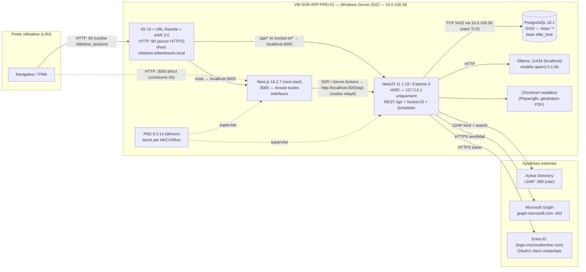
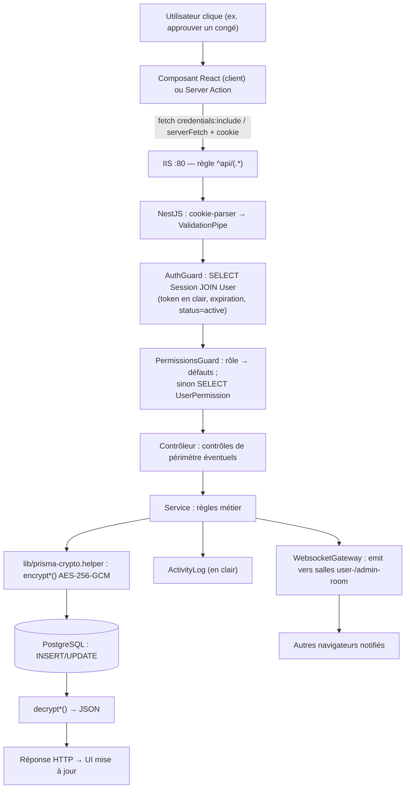

# 02 — Architecture technique

> Niveaux de preuve : **[Code]**, **[Env]**, **[Doc]**, **[À confirmer]**, **[Non implémenté]**, **[Partiel]** (voir `README.md`).

---

## 1. Vue d'ensemble

Le frontend et le backend sont **deux applications séparées** (deux `package.json`, deux processus PM2, deux ports), regroupées dans **un seul dépôt Git** (monorepo sans outil de workspace) **[Code][Env]**.



Ports, adresses et protocoles : vérifiés par `Get-NetTCPConnection`, lecture des `.env` (valeurs non secrètes) et des `web.config` IIS le 13/10/2026 **[Env]**. Le site IIS actif `ELITE TIME` (physicalPath `C:\inetpub\wwwroot`, liaison `http *:80:elitetime.elitenetwork.local`) est établi à partir de la copie `C:\backups\EliteTime\applicationHost.config.bak_20260527_090311` ; la configuration courante n'a pas pu être lue sans élévation **[À confirmer]**.

---

## 2. Stack technique

### 2.1 Runtimes et outils installés sur le serveur

| Couche | Technologie | Version vérifiée | Utilisation | Preuve |
|---|---|---|---|---|
| OS | Windows Server 2022 Standard | 10.0.20348 | Hôte unique | `Win32_OperatingSystem` [Env] |
| Virtualisation | VMware | VMware20,1 | VM, 4 vCPU logiques, 8 Go RAM, disque C: 99 Go (41 Go libres) | `Win32_ComputerSystem` [Env] |
| Runtime | Node.js | v24.13.0 | Frontend + backend | `node -v` [Env] |
| Gestionnaire de paquets | npm | 11.18.0 | Installation | `npm -v` [Env] |
| Supervision process | PM2 | 6.0.14 (global `C:\npm-global`) | Démon + 2 apps | `package.json` de pm2 [Env] |
| Démarrage auto | pm2-windows-startup | — | Clé `HKCU\…\Run\PM2` | Registre [Env] |
| Service Windows (inactif) | NSSM `PM2-EliteTime` | — | Arrêté, cible obsolète | `Win32_Service` [Env] |
| Reverse proxy | IIS 10 + URL Rewrite + ARR 3.0 | ARR 3.0 (`X-Powered-By: ARR/3.0`) | Routage :80 | En-têtes HTTP, `C:\Program Files\IIS` [Env] |
| Base de données | PostgreSQL | 18.1 | Service `postgresql-x64-18` | `postgres -V` [Env] |
| IA locale | Ollama | non relevée | `localhost:11434` | `Get-NetTCPConnection` [Env] |
| Navigateurs headless | Playwright browsers | chromium-1217 / 1228 | PDF | `%LOCALAPPDATA%\ms-playwright` [Env] |
| Git | Git for Windows | 2.52.0 | Récupération du code | `git --version` [Env] |
| CI (cible) | Node.js | 20 (GitHub Actions) | Build CI | `.github/workflows/ci.yml` [Code] |
| Conteneurs (non utilisés en prod) | Docker / node:22-alpine | — | Fichiers présents, non déployés | `docker-compose.yml`, aucun service Docker [Code][Env] |

> ⚠️ La CI compile avec **Node 20**, les Dockerfiles utilisent **Node 22**, la production tourne en **Node 24** : trois versions différentes **[Code][Env]**.

### 2.2 Dépendances directes — backend (`backend/package.json`, versions installées dans `node_modules`)

| Couche | Bibliothèque | Version installée | Utilisation |
|---|---|---|---|
| Framework | @nestjs/core, @nestjs/common, @nestjs/platform-express | 11.1.19 | API REST |
| HTTP | express | 5.2.1 | Adaptateur Nest |
| Temps réel | @nestjs/platform-socket.io, socket.io | 11.1.19 / 4.8.3 | Gateway WebSocket |
| Planification | @nestjs/schedule | 5.0.1 | `@Cron`, `@Interval` |
| Rate limiting | @nestjs/throttler | 6.5.0 | **Installé mais jamais utilisé** [Code] |
| ORM | @prisma/client, prisma, @prisma/adapter-pg, pg | 7.8.0 / 7.8.0 / 7.8.0 / 8.20.0 | Accès PostgreSQL |
| Validation | class-validator, class-transformer | 0.15.1 / 0.5.1 | DTO (module absences uniquement) |
| Auth | ldapts | 8.1.7 | LDAP AD |
| Hachage | bcryptjs | 3.0.3 | Mots de passe locaux (coût 10) |
| Cookies | cookie-parser | 1.4.7 | Lecture du cookie de session |
| Chiffrement | `node:crypto` (natif) | Node 24 | AES-256-GCM |
| E-mail | @microsoft/microsoft-graph-client, @azure/identity | 3.0.7 / 4.13.1 | Envoi via Graph |
| Excel | exceljs | 4.4.0 | Rapports .xlsx |
| PDF | playwright | 1.59.1 | HTML → PDF (Chromium) |
| Dates | date-fns | 4.1.0 | Calculs de dates |
| Divers | @hono/node-server | déclaré | **Non utilisé dans `src/`** ; vulnérable (voir `08`) |
| Tests | jest, ts-jest, supertest | 30.4.2 / 29.x / 7.x | Tests unitaires |
| Langage | TypeScript | 5.9.3 | Compilation `nest build` |

### 2.3 Dépendances directes — frontend (`frontend/package.json`)

| Couche | Bibliothèque | Version installée | Utilisation |
|---|---|---|---|
| Framework | next | 16.2.7 | App Router, SSR, Server Actions, `proxy.ts` |
| UI | react / react-dom | 19.2.7 / 19.2.0 | Rendu |
| Composants | Radix UI (≈ 25 paquets), shadcn/ui (`components.json`), lucide-react 1.17.0 | — | Design system |
| Styles | tailwindcss | 4.3.0 | CSS utilitaire |
| Formulaires | react-hook-form 7.77.0, @hookform/resolvers, zod 4.4.3 | — | Saisie + validation client |
| Tableaux | @tanstack/react-table | 8.21.3 | Listes |
| Graphiques | recharts | 2.15.4 | Tableaux de bord |
| Temps réel | socket.io-client | 4.8.3 | Notifications |
| Notifications UI | sonner | — | Toasts |
| Langage | TypeScript | 6.0.3 | — |
| Divers | `node-windows` (devDependency) | — | Non utilisé en production [À confirmer] |

Les dépendances indirectes ne sont pas inventoriées ici ; elles sont figées par `package-lock.json` (backend et frontend). Les vulnérabilités connues sont listées dans `08-tests-et-qualite.md`.

---

## 3. Architecture frontend

### 3.1 Organisation

```
frontend/
├── app/                    # App Router
│   ├── (app)/              # Pages authentifiées (layout avec sidebar + widget IA)
│   ├── login/, 403/, page.tsx
│   └── api/                # Route handlers : proxys vers NestJS (login, me, rapports, permissions…)
├── proxy.ts                # « Middleware » Next 16 : redirections, en-têtes de sécurité, rate limit mémoire
├── src/
│   ├── actions/{admin,manager,employee}/   # Server Actions → serverFetch() → NestJS
│   ├── components/{ui,admin,ai,charts,customs,pwa}/
│   ├── features/{admin,manager,employee}/  # Composants par rôle
│   ├── contexts/ (auth, permissions…), hooks/
│   ├── lib/ api-client.ts (navigateur), server-api.ts (serveur), websocket-client.ts,
│   │        navigation-registry.ts, navigation-guard.ts, security/{rbac,headers,access-control}.ts
│   ├── schemas/ (zod), types/, data/mockData.ts (données fictives, non utilisées)
└── public/ manifest.webmanifest, sw.js (PWA)
```

≈ 30 000 lignes TypeScript/TSX dans `app/` + `src/` (dont 61 composants UI génériques) **[Code]**.

### 3.2 Communication avec le backend

Trois chemins coexistent **[Code]** :

| Chemin | Utilisé par | URL | Cookie |
|---|---|---|---|
| **Navigateur → IIS → NestJS** | `src/lib/api-client.ts` (`fetch`, `credentials: "include"`) | `NEXT_PUBLIC_API_URL` = `http://elitetime.elitenetwork.local/api` | Envoyé automatiquement (même origine) |
| **Serveur Next → NestJS** | Server Components / Server Actions via `src/lib/server-api.ts` | `API_URL` = `http://localhost:4000/api` | Relayé manuellement (`Cookie: elitetime_session=…`) |
| **Route handlers Next** (`app/api/*`) | Quelques écrans (rapports, permissions, LDAP) | Relais vers `API_URL` | Relayé |

Dans IIS, `/api/login`, `/api/logout`, `/api/me`, `/api/permissions`, `/api/user/permissions` sont **réécrits directement vers NestJS** (`/api/auth/*`) ; les route handlers Next.js correspondants ne servent donc qu'en développement **[Env]** (`C:\inetpub\wwwroot\web.config`).

### 3.3 Contrôle d'accès côté client

- `proxy.ts` ne redirige vers `/login` que pour `/` et `/dashboard*` en l'absence de cookie **[Code]**.
- Chaque page serveur appelle `requireNavigationAccess…()` (`src/lib/navigation-guard.ts`), qui interroge `GET /auth/me` et `GET /auth/permissions` puis redirige vers `/403` **[Code]**.
- Pages **sans garde** : `/test-permissions`, `/test-reports`, `/permissions-guide` **[Code]**. Les données restent protégées par le backend.
- Ces contrôles sont **ergonomiques** : la sécurité réelle dépend du backend (voir `04`).

### 3.4 États, formulaires, erreurs, chargement

- État : React Context (`src/contexts/`), état local ; pas de bibliothèque de cache de requêtes **[Code]**.
- Formulaires : react-hook-form + zod (`src/schemas/`) **[Code]**.
- Erreurs : `serverFetch` redirige vers `/login` sur 401 ou backend injoignable, et **renvoie `null` sur toute erreur GET** (les pages affichent alors un état vide, l'erreur n'est visible que dans les logs) **[Code]**.
- WebSocket : `src/lib/websocket-client.ts`, transports `polling` puis `websocket`, 10 tentatives de reconnexion **[Code]**.
- Téléchargements : réponses binaires (PDF/XLSX) relayées par les route handlers ou directement **[Code]**.
- `localStorage` : uniquement l'état ouvert/fermé du widget IA et le refus d'installation PWA **[Code]**.

### 3.5 Performance et accessibilité (observations)

- `GET /users` est appelé avec `limit=1000` par défaut et le backend déchiffre tous les utilisateurs pour filtrer par département (voir `09`) **[Code]**.
- `Cache-Control: no-store` est posé sur **toutes** les réponses par `proxy.ts`, y compris les pages statiques (pas de cache navigateur) **[Code][Env]**.
- Accessibilité : composants Radix (ARIA natif) ; aucun audit outillé réalisé **[À confirmer]**.

---

## 4. Architecture backend

### 4.1 Modules NestJS (`backend/src/app.module.ts`)

| Module | Contrôleur (préfixe) | Rôle |
|---|---|---|
| `AuthModule` | `/api/auth` | Login LDAP/local, sessions, `me`, permissions |
| `UsersModule` | `/api/users` | Employés |
| `PointagesModule` | `/api/pointages` | Pointages, saisie manager |
| `BreaksModule` | `/api/breaks` | Pauses |
| `AbsencesModule` | `/api/absences` | Congés |
| `DepartmentsModule` / `PositionsModule` | `/api/departments`, `/api/positions` | Organisation |
| `DashboardModule` | `/api/dashboard` | Statistiques |
| `ReportsModule` | `/api/reports` | PDF / Excel |
| `EmailSchedulingModule` | `/api/email-scheduling` | Configuration des jobs |
| `EmailModule` | — | `ScheduledEmailService` (génération + envoi) |
| `SchedulerModule` | — | Tâches `@Cron` / `@Interval` |
| `LdapModule` | `/api/ldap` | Synchro AD |
| `PermissionsModule` | `/api/permissions` | Permissions individuelles |
| `LogsModule` | `/api/logs` | Journal d'activité |
| `SettingsModule` | `/api/settings` | Paramètres |
| `AiModule` | `/api/ai` | Assistant IA |
| `WebsocketModule` | Socket.IO `/socket.io` | Temps réel |
| `PrismaModule` | — | `PrismaService` |
| `SeedModule` | `/api/admin/seed` | **Chargé seulement hors production** |

≈ 15 000 lignes TypeScript dans `backend/src` (hors client Prisma généré) **[Code]**.

### 4.2 Pipeline d'une requête

`main.ts` **[Code]** : `cookie-parser` → préfixe `/api` → `ValidationPipe({ whitelist: true, transform: true })` global → CORS (`NEXT_ALLOWED_ORIGINS`, `credentials: true`) → `trust proxy = 1` → écoute `127.0.0.1:PORT`.

Pas de `helmet`, pas de filtre d'exception global personnalisé, pas de `ThrottlerGuard`, pas d'intercepteur de journalisation **[Code]**.

### 4.3 Couches

- **Contrôleurs** : décorateurs `@UseGuards(AuthGuard, PermissionsGuard)` + `@RequirePermissions(...)` ; certains contrôles de périmètre sont codés à la main dans les contrôleurs (`canViewOtherUser`, `resolvePermissionSet`) **[Code]**.
- **Services** : logique métier + accès Prisma direct (pas de couche repository) **[Code]**.
- **Validation** : DTO `class-validator` **uniquement** dans `absences/dto` et `ai/dto` ; ailleurs les corps sont typés par des types TypeScript inline, ce qui rend `whitelist: true` **sans effet** (aucune propriété décorée) **[Code]**.
- **Transactions** : une seule (`departments.service.ts:41`) ; les opérations multi-écritures (création utilisateur + `HiddenUsername`, remplacement des destinataires e-mail, pointage) ne sont pas atomiques **[Code]**.
- **Exceptions** : exceptions HTTP Nest ; erreurs inattendues → 500 générique du framework **[Code]**.
- **Asynchrone** : tout s'exécute dans le processus web (scheduler, génération PDF Chromium, appels LDAP, IA) — aucun worker séparé **[Code][Env]**.

---

## 5. Flux de données : de l'action utilisateur à la base



---

## 6. Communications temps réel

Voir `06-api-et-integrations.md` §3. Résumé : Socket.IO 4 sur le même processus NestJS, authentification par le cookie de session lu dans le handshake, salles `user-<id>`, `<role>-room`, `admin-room` (managers et chefs d'équipe y sont aussi joints) **[Code]**.

## 7. Tâches automatiques

Voir `06-api-et-integrations.md` §5. Toutes sont exécutées **dans le processus backend** par `@nestjs/schedule` ; un redémarrage ou une seconde instance modifie leur comportement (déduplication en mémoire) **[Code]**.
