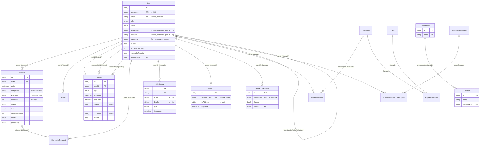
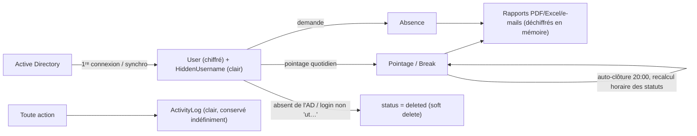

# 03 — Base de données

> Source de vérité : `backend/prisma/schema.prisma` (commit `e3878d4`), dossiers `backend/prisma/migrations/`, configuration PostgreSQL lue sur le serveur. Aucune donnée réelle n'a été consultée.

---

## 1. Moteur, connexion et configuration

| Élément | Valeur | Preuve |
|---|---|---|
| Moteur | PostgreSQL **18.1** (service Windows `postgresql-x64-18`, compte `NT AUTHORITY\NetworkService`) | `postgres -V`, `Win32_Service` [Env] |
| Répertoire de données | `C:\Program Files\PostgreSQL\18\data` (même disque C: que l'OS et l'application) | Chemin du service [Env] |
| Base | `elite_time`, schéma `public` | `prisma migrate status` [Env] |
| Hôte utilisé par l'application | `10.0.100.58:5432` (adresse LAN du serveur lui-même, **pas** `localhost`) | `backend/.env` (valeur non secrète) [Env] |
| Paramètres de connexion | `connect_timeout=60&pool_timeout=30&socket_timeout=60`, **aucun `sslmode`** | `backend/.env` [Env] |
| `listen_addresses` | `'*'` (toutes interfaces) | `postgresql.conf` [Env] |
| `ssl` | non activé (paramètre absent → `off`) | `postgresql.conf` [Env] |
| Accès réseau autorisés | `127.0.0.1/32`, `::1/128`, **`10.0.100.0/24`**, **`10.0.210.0/24`** — méthode `scram-sha-256` ; aucune règle `hostssl` | `pg_hba.conf` [Env] |
| Pare-feu Windows | Règle « PorstgreSQL TCP 5432 » autorisée profils Domaine/Privé | `Get-NetFirewallRule` [Env] |
| `max_connections` / `shared_buffers` | 100 / 128 Mo (valeurs par défaut) | `postgresql.conf` [Env] |
| `timezone` (serveur PG) | `Europe/Paris` | `postgresql.conf` [Env] |
| Journalisation | `logging_collector = on` ; 438 fichiers, ≈ 2 Mo dans `data\log` ; `log_min_duration_statement` non défini (pas de log des requêtes lentes) | [Env] |
| Archivage WAL / PITR | Non configuré (`archive_mode` absent) | [Env] |
| Pool applicatif | `pg.Pool` via `@prisma/adapter-pg` (taille par défaut du driver, non configurée) | `prisma.service.ts` [Code] |
| Compte applicatif | Un seul compte dans `DATABASE_URL` (droits exacts non vérifiés) | [À confirmer] |
| Nombre de tables | 17 modèles Prisma + `_prisma_migrations` = 18 tables | `schema.prisma`, dump de schéma [Code] |
| État des migrations | « Database schema is up to date! » — 33 migrations | `npx prisma migrate status` (lecture seule) [Env] |

> Le frontend possède aussi une `DATABASE_URL` dans `frontend/.env` alors qu'il n'accède pas à la base (aucun client Prisma dans `frontend/`) **[Code][Env]**.

---

## 2. Inventaire des modèles

| Modèle | Rôle | Clé | Volumétrie attendue | Champs chiffrés (AES-256-GCM applicatif) |
|---|---|---|---|---|
| `User` | Comptes | `id` cuid | Faible (≈ effectif) | `email`, `username`, `firstname`, `lastname`, `department`, `position` |
| `HiddenUsername` | Index **en clair** des identifiants (login → userId) + masquage | `id` cuid, `username` unique | = User | **Aucun** (identifiant en clair, par conception) |
| `Pointage` | Sessions de présence | `id` cuid | Forte (≥ 1/employé/jour) | `entryTime`, `exitTime`, `lateReason`, `earlyExitReason` |
| `Break` | Pauses | `id` cuid | Moyenne | `startTime`, `endTime` |
| `Absence` | Congés / absences | `id` cuid | Moyenne | `reason`, `comment` |
| `CorrectionRequest` | Demandes de correction | `id` cuid | **Inutilisée** | (helpers prévus, non utilisés) |
| `ActivityLog` | Journal d'activité | `id` cuid | **Forte et sans purge** | **Aucun** (écrit en clair) |
| `SystemSettings` | Paramètres (singleton `id = 1`) | `id` Int | 1 ligne | Aucun |
| `Department` | Départements | `id` cuid, `name` unique | Faible | Aucun |
| `Position` | Postes | `id` cuid, `(name, departmentId)` unique | Faible | Aucun |
| `Session` | Sessions d'authentification | `id` cuid, `sessionToken` unique | Moyenne (24 h, purge partielle) | **Aucun** (token, IP, user-agent en clair ; `encryptSession` jamais appelé) |
| `Permission` | Catalogue de permissions (111 seedées) | `id` cuid, `name` unique | Faible | Aucun |
| `UserPermission` | Permissions individuelles | `id`, `(userId, permissionId)` unique | Faible | Aucun |
| `Page` | Pages et rôles autorisés | `id`, `code`/`path` uniques | **Inutilisée** par le code | Aucun |
| `PagePermission` | Liaison page/permission | `(pageId, permissionId)` | **Inutilisée** | Aucun |
| `ScheduledEmailJob` | Jobs d'e-mail (1 par type) | `id`, `type` unique | 3 lignes | Aucun |
| `ScheduledEmailJobRecipient` | Destinataires | `id`, `(jobId,userId)` et `(jobId,email)` uniques | Faible | `email` |

**Enums** : `UserRole`, `UserStatus`, `PointageStatus` (`normal`, `late`, `incomplete`, `admin_closed`), `PointageSource`, `PointedBy`, `AbsenceType`, `AbsenceStatus`, `CorrectionStatus`, `ActivityType`, `ScheduledEmailType`, `DailyReportMode`, `PermissionRisk`.

---

## 3. Diagramme ERD

---

## 4. Dictionnaire de données — entités principales

### 4.1 `User`

| Champ | Type | Obligatoire | Règle / remarque |
|---|---|---|---|
| `id` | String (cuid) | Oui | PK |
| `username` | String | Oui | `@unique` **mais chiffré avec un IV aléatoire** : deux chiffrements du même login diffèrent, l'unicité SQL est donc inopérante ; l'unicité réelle est assurée par `HiddenUsername.username` |
| `email` | String? | Non | Même remarque (unicité inopérante) |
| `role` | `UserRole` | Oui | défaut `employee` |
| `status` | `UserStatus` | Oui | `active`/`inactive`/`deleted` (soft delete) |
| `department`, `position` | String? | Non | Chiffrés, texte libre sans lien vers `Department`/`Position` |
| `password` | String? | Non | Hash **bcrypt** (coût 10) pour comptes locaux, `null` pour AD |
| `isLocal` | Boolean | Oui | `true` = compte local |
| `hiddenFromLists`, `includeInReports` | Boolean | Oui | Affichage / inclusion dans les rapports |
| `teamLeadId` | String? | Non | Auto-relation ; **non utilisée** pour l'autorisation |
| `avatar` | String? | Non | — |

### 4.2 `Pointage`

| Champ | Type | Obligatoire | Règle / remarque |
|---|---|---|---|
| `date` | DateTime | Oui | Horodatage de création (employé) ou minuit local (saisie manager) — **deux conventions** |
| `entryTime` / `exitTime` | String? | Non | `HH:mm` chiffré ; aucune validation de format côté API |
| `duration` | Int | Oui | Minutes, pause forfaitaire déduite (voir `01` §5.1) |
| `status` | `PointageStatus` | Oui | Recalculé périodiquement |
| `isActive` | Boolean | Oui | Session ouverte |
| `sessionNumber` | Int | Oui | 1..n |
| `source`, `pointedBy` | Enums | Oui | Redondants (`EMPLOYEE/ADMIN/MANAGER` vs `employee/admin/manager`) |
| `lateReason`, `earlyExitReason` | String? | Non | Chiffrés, longueur non bornée |
| Contraintes | `@@unique([userId, date, sessionNumber])`, `@@index([userId, date])` | | L'unicité est faible car `date` contient l'heure à la milliseconde |

### 4.3 `Absence`

| Champ | Type | Obligatoire | Règle |
|---|---|---|---|
| `type` | `AbsenceType` | Oui | `conge`, `maladie`, `autre` |
| `startDate`, `endDate` | DateTime | Oui | fin ≥ début ; pas de chevauchement (contrôle applicatif, non transactionnel) |
| `reason` | String | Oui | Chiffré, ≤ 500 caractères (DTO) |
| `status` | `AbsenceStatus` | Oui | Machine à états (voir `01` §5.6) |
| `comment` | String? | Non | Motif de refus, chiffré, ≤ 1000 |
| `approvedById`, `rejectedById` | String? | Non | FK `User`, `onDelete: SetNull` |
| `hidden` | Boolean | Oui | Masquage d'affichage |
| Index | `(userId, status)`, `(status, startDate)`, `(hidden)` | | |

### 4.4 `Session`

| Champ | Remarque |
|---|---|
| `sessionToken` | `randomUUID()` (122 bits d'aléa), **stocké en clair**, unique |
| `expiresAt` | Création + 24 h ; pas de prolongation glissante |
| `ipAddress`, `userAgent` | En clair |
| Purge | Uniquement quand un token expiré est présenté (`auth.guard.ts`) ou à la déconnexion ; **aucune purge planifiée** |

### 4.5 `SystemSettings`

`workStartTime` (08:45), `workEndTime` (17:30), `maxSessionEndTime` (20:00), `breakDuration` (60), `overtimeThreshold` (**non utilisé**), `holidays` JSON (**non utilisé**), quatre interrupteurs de notification (**non utilisés**), `ldapSyncEnabled`, `ldapSyncIntervalMinutes` (**non utilisé**), `ldapLastSyncAt`, `dailyReportMode`, `timezone` (`Europe/Paris`, utilisé uniquement pour le calcul du jour de la semaine/mois des e-mails).

---

## 5. Relations et stratégies de suppression

- Presque toutes les relations vers `User` sont en **`onDelete: Cascade`** : une suppression physique d'un utilisateur efface ses pointages, absences, sessions, permissions **et ses journaux d'activité** **[Code]**. L'application n'effectue que des **soft delete** (`status = deleted`), ce qui limite le risque à une intervention SQL manuelle.
- `Absence.approvedBy/rejectedBy` : `SetNull` (l'historique de décision perd l'auteur si le décideur est supprimé).
- `Department → Position` : `Cascade` — supprimer un département supprime ses postes ; les utilisateurs qui portent ces libellés (texte chiffré) ne sont pas modifiés.
- `Absence` : annulation = `status = cancelled` ; masquage = `hidden = true` (soft delete d'affichage).
- `Pointage` : **suppression physique** possible des sessions > 1 (`deleteExtraSessions`).

---

## 6. Cycle de vie des données

- **Rétention** : aucune politique ; pointages, absences, journaux et sessions expirées s'accumulent **[Code]**.
- **Données personnelles** : identité, e-mail, département, poste, horaires de présence, motifs (retard, départ, absence — un motif d'absence `maladie` peut contenir des données de santé), adresses IP, user-agent, contenu des requêtes IA (non persisté en base, à confirmer dans les logs Ollama).
- **Données dans les logs** : `ActivityLog` contient en clair noms complets, identifiants de connexion échoués, IP, identifiants techniques ; les journaux PM2 contiennent des adresses e-mail de destinataires (56 occurrences dans `elitetime-backend-out.log`) **[Env]**.

---

## 7. Index et risques de performance

| Requête fréquente | Index disponible | Risque |
|---|---|---|
| `Pointage` par `userId` + plage `date` | `@@index([userId, date])` | OK |
| `Pointage` actifs du jour (scheduler, chaque minute / rappel) | aucun index sur `isActive` | Parcours séquentiel croissant avec l'historique |
| `Pointage` `status = incomplete` (à chaque sortie + toutes les heures) | aucun | Idem |
| `Break` par `userId` + `date` | **aucun index** | Parcours séquentiel |
| `ActivityLog` : comptage des échecs de connexion (`action`, `type`, `timestamp`, `details LIKE`) à chaque login | **aucun index** | Coût croissant à chaque connexion ; table sans purge |
| `ActivityLog` listing paginé par `timestamp desc` | aucun | Tri complet |
| `UserPermission` par `userId` (à chaque requête non couverte par les défauts du rôle) | `@@index([userId])` | OK |
| Filtrage `User` par département | impossible en SQL (chiffré) | Lecture + déchiffrement de **tous** les utilisateurs à chaque appel (users, absences équipe, rapports, dashboard manager) |
| Recherche d'utilisateur | via `HiddenUsername` (clair) | OK |

---

## 8. Cohérence schéma / migrations / code

| Constat | Gravité | Preuve |
|---|---|---|
| **29 des 33 migrations sont des fichiers vides** (57 octets : « Migration déjà appliquée. Stub de synchronisation. »). Seules les 4 migrations de juin–août 2026 contiennent du SQL. **Une base neuve ne peut pas être créée par `prisma migrate deploy`** : le Dockerfile backend, qui l'exécute au démarrage, échouerait sur une base vide. | **Élevée** (reprise après sinistre) | `wc -c backend/prisma/migrations/*/migration.sql` [Code] |
| Un dump de schéma `scripts/dumps/elitetime-schema-20260606.sql` (18 tables, sans données) existe **localement**, exclu de Git, et **antérieur** aux migrations d'août 2026 | Moyenne | `.gitignore`, fichier local [Env] |
| L'état de la base de production correspond aux 33 migrations | Info | `prisma migrate status` [Env] |
| `Page`, `PagePermission`, `CorrectionRequest` existent sans usage applicatif | Faible | Recherche dans `backend/src` [Code] |
| `@unique` sur des champs chiffrés à IV aléatoire (`User.username`, `User.email`, `HiddenUsername` exclu) : contrainte sans effet métier | Moyenne | `schema.prisma:13-14`, `crypto.ts` [Code] |
| La synchro LDAP tente `user.findUnique({ username: encrypt(x) })` et `updateMany({ username: { in: [clairs] } })` : ces requêtes **ne peuvent jamais correspondre** (code mort) | Faible | `ldap-sync.service.ts:146-149, 294-296` [Code] |
| `User.department/position` (texte) vs tables `Department/Position` : aucune intégrité référentielle | Moyenne | `schema.prisma` [Code] |
| Script `backend/scripts/migrate-rbac-granular.ts` et `scripts/*.js` de correction de données exécutés manuellement, hors historique Prisma | Moyenne | `backend/package.json` scripts [Code] |

---

## 9. Risques de duplication ou d'incohérence

- Double pointage concurrent (absence de transaction/verrou) — voir `01` §5.1.
- Remplacement des destinataires d'un job e-mail : `deleteMany` puis `createMany` sans transaction (`email-scheduling.service.ts:151-174`) — une erreur intermédiaire laisse un job sans destinataire.
- Création d'utilisateur : `user.create` puis `hiddenUsername.create` sans transaction (`users.service.ts:140-160`) — un échec laisse un utilisateur introuvable par son login.
- Fermeture automatique « scheduler » vs « paresseuse » : données différentes (heure de sortie absente ou présente).
- Deux calculs de durée travaillée (pause forfaitaire en base vs pauses réelles dans les rapports).
