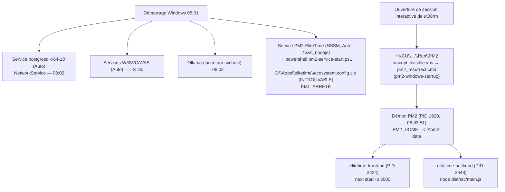

# 05 — Infrastructure, processus d'exécution et déploiement

> Toutes les informations marquées **[Env]** ont été relevées le 13/10/2026 entre 08:05 et 09:30 (heure serveur) par des commandes en lecture seule depuis la session `ELITENETWORK\ut08rm`, **non élevée** (jeton administrateur filtré par l'UAC). Certaines informations (configuration IIS courante, journaux IIS, BitLocker, propriétaires des processus) n'étaient donc pas accessibles.

---

## 1. Infrastructure réelle

| Élément | Valeur | Niveau |
|---|---|---|
| Nom du serveur | `SVR-APP-PRD-01` (domaine `elitenetwork.local`, membre du domaine) | [Env] |
| Rôle | Serveur applicatif **et** serveur de base de données **et** serveur d'IA (tout-en-un) | [Env] |
| Hébergement | Machine virtuelle **VMware** (`VMware20,1`) | [Env] |
| OS | Windows Server 2022 Standard, build 10.0.20348 | [Env] |
| CPU / RAM | 4 processeurs logiques / 8 Go (2,2 Go libres lors du relevé) | [Env] |
| Stockage | Un volume `C:` de 99 Go (41 Go libres) : OS, application, PostgreSQL, journaux, modèles IA | [Env] |
| Adresse IP | `10.0.100.58/24` (interface `Ethernet0`) | [Env] |
| DNS | `elitetime.elitenetwork.local` → CNAME `SVR-APP-PRD-01.elitenetwork.local` → A `10.0.100.58` | `Resolve-DnsName` [Env] |
| Fuseau horaire Windows | `W. Central Africa Standard Time` (UTC+1, sans heure d'été ; Node le résout en `Africa/Lagos`) | [Env] |
| Dernier démarrage | 13/10/2026 08:01:40 | [Env] |
| Accès distant | RDP (3389) et WinRM HTTP (5985) en écoute | [Env] |
| Logiciels tiers notables | VMware Tools, Azure Arc Setup, **Prim'X ZoneCentral** (chiffrement de fichiers — périmètre inconnu) | Clés `Run` [Env] |

### 1.1 Ports en écoute (relevé `Get-NetTCPConnection`)

| Port | Adresse | Processus | Rôle | Exposition |
|---|---|---|---|---|
| 80 | `::` (toutes) | System (HTTP.sys / IIS) | Point d'entrée de l'application | LAN — voulu |
| 443 | — | — | **Aucune écoute HTTPS** (règles pare-feu 443 existantes mais sans service) | — |
| 3000 | `::` (toutes) | node (PID 3424) | Next.js | **LAN — non voulu** (contourne IIS) |
| 4000 | `127.0.0.1` | node (PID 3648) | NestJS | Local uniquement — correct |
| 5432 | `0.0.0.0` / `::` | postgres | PostgreSQL 18 | LAN (2 sous-réseaux autorisés dans `pg_hba.conf`) |
| 11434 | `127.0.0.1` | ollama | Modèle IA | Local uniquement |
| 3389 | toutes | svchost | RDP | LAN |
| 5985 | toutes | System | WinRM | LAN |

### 1.2 Pare-feu Windows

Profils Domaine/Privé/Public **activés** ; action entrante par défaut « NotConfigured » (= blocage par défaut de Windows). Règles entrantes pertinentes : `IIS HTTP/HTTPS` (80/443, tous profils), `Allow Node.js port 3000` (**Any**), `Allow Socket.io port 4000` (Any, ×2, sans effet car 4000 est local), `PorstgreSQL TCP 5432` (Domaine/Privé), WinRM 5985 **[Env]**.

### 1.3 Reverse proxy IIS

- Site **`ELITE TIME`** (id 2), pool `EliteTime`, `physicalPath = C:\inetpub\wwwroot`, liaison **`http *:80:elitetime.elitenetwork.local`** uniquement — d'après la sauvegarde `C:\backups\EliteTime\applicationHost.config.bak_20260527_090311` **[Env — état au 27/05/2026, à confirmer sur la configuration courante]**.
- ARR : `proxy enabled="true"`, `timeout="01:00:00"`, `preserveHostHeader="true"` ; WebSocket activé **[Env]**.
- Règles de réécriture actives (`C:\inetpub\wwwroot\web.config`, 26/05/2026) **[Env]** :

| Ordre | Motif | Cible |
|---|---|---|
| 1 | `^socket\.io(.*)` | `http://localhost:4000/socket.io{R:1}` |
| 2 | `^api/ai/(.*)` | `http://localhost:4000/api/ai/{R:1}` (SSE) |
| 3–7 | `^api/login$`, `^api/logout$`, `^api/me$`, `^api/permissions$`, `^api/user/permissions$` | `http://localhost:4000/api/auth/…` |
| 8 | `^api/(.*)` | `http://localhost:4000/api/{R:1}` |
| 9 | `(.*)` | `http://localhost:3000/{R:1}` |

  Chaque règle positionne `X-Forwarded-For = {REMOTE_ADDR}` (écrase la valeur cliente), `X-Forwarded-Proto = http`, `X-Forwarded-Host`, `X-Real-IP`.
- Deux autres `web.config` existent : `C:\inetpub\elitetime\web.config` (18/05, cible `10.0.100.58:4000`, **non fonctionnelle** puisque NestJS n'écoute que sur `127.0.0.1`) et `C:\inetpub\wwwroot\elitetime\web.config` (25/06, ajoute des règles vers les route handlers Next.js pour `/api/reports`, `/api/admin`, `/api/rapports`, `/api/ldap`, `/api/activity`). **Lequel est réellement servi à l'URL racine dépend de la configuration courante** ; la sauvegarde de mai désigne `C:\inetpub\wwwroot` **[À confirmer]**. Conséquence potentielle : les écrans qui appellent `/api/admin/users/:id/permissions` ou `/api/rapports/*` reçoivent un 404 NestJS si c'est `wwwroot\web.config` qui s'applique.
- **TLS** : aucun certificat lié, aucune liaison HTTPS **[Env]**.
- **Journaux IIS** : `C:\inetpub\logs\LogFiles` (accès refusé sans élévation) **[À confirmer]**.

---

## 2. Processus d'exécution

### 2.1 Chaîne de démarrage réellement constatée

**Conséquence majeure** : les applications ne sont relancées après un redémarrage **que si l'utilisateur `ut08rm` ouvre une session** ; elles tournent dans le contexte de ce compte personnel (administrateur local). Le service Windows prévu pour cela (`PM2-EliteTime`) est arrêté, pointe vers un chemin inexistant (`C:\Apps\elitetime\…`) et ses journaux (`C:\pm2-data\logs\service-*.log`, 60 Mo) montrent une ancienne architecture (`elitetime-socket`, `elitetime-worker`, `tsx`) en échec depuis mai 2026 **[Env]**.

### 2.2 Fiches processus

**Processus `elitetime-backend`** (source : `C:\pm2-data\dump.pm2`, `ecosystem.config.js` racine) :

| Élément | Information |
|---|---|
| Nom | `elitetime-backend` (PM2), `node.exe` PID 3648 |
| Rôle | API REST NestJS, Socket.IO, scheduler, génération PDF/Excel, LDAP, Graph, proxy IA |
| Commande | `node C:\APPS\ELITE_TIME\backend\dist\src\main.js` (cwd `C:\APPS\ELITE_TIME\backend`) |
| Port | `127.0.0.1:4000` (vérifié) |
| Compte d'exécution | Session de `ut08rm` (déduit de la chaîne de démarrage ; propriétaire non lisible sans élévation) [À confirmer] |
| Mode | `fork`, 1 instance |
| Mémoire | `max_memory_restart = 1 Go` ; ≈ 41 Mo de working set au relevé |
| Redémarrage | `autorestart: true`, `restart_delay: 5000` ms ; pas de `max_restarts` ni `min_uptime` |
| Logs | `C:\pm2-data\logs\elitetime-backend-out.log` (3,4 Mo), `…-error.log` (115 Ko) ; **pas de rotation** (module `pm2-logrotate` absent, `module_conf.json` vide) |
| Variables | `NODE_ENV=production`, `PORT=4000` dans PM2 ; secrets lus par `dotenv` depuis `backend/.env` |
| Dépendances | PostgreSQL, AD (LDAP), Graph, Ollama, Chromium (Playwright) |
| Santé | **Aucune route de santé** (`GET /api/` renvoie « Hello World! ») ; pas de sonde externe |

**Processus `elitetime-frontend`** :

| Élément | Information |
|---|---|
| Nom | `elitetime-frontend`, `node.exe` PID 3424 |
| Rôle | Rendu Next.js (SSR, Server Actions, route handlers) |
| Commande | `node …\frontend\node_modules\next\dist\bin\next start -p 3000` (cwd `C:\APPS\ELITE_TIME\frontend`, build dans `.next-build`) |
| Port | `:::3000` (toutes interfaces, `HOSTNAME=0.0.0.0`) |
| Mémoire | `max_memory_restart = 1 Go` ; ≈ 12 Mo de working set au relevé |
| Redémarrage | identique au backend |
| Logs | `C:\pm2-data\logs\elitetime-frontend-out.log` (4,6 Mo), `…-error.log` (**11,7 Mo**) ; pas de rotation |
| Santé | Aucune |

**Autres processus**

| Processus | Lancement | Compte | Remarque |
|---|---|---|---|
| PostgreSQL 18 | Service Windows, Auto | `NetworkService` | 9 processus `postgres.exe` |
| IIS (W3SVC/WAS) | Services Windows | `LocalSystem` / identité du pool `EliteTime` | — |
| Ollama | Démarré par `svchost` (tâche planifiée ou service non listé) | [À confirmer] | Modèles dans `C:\Users\ut08rm\.ollama\models` (profil personnel) |
| Chromium | Lancé à chaque export PDF par Playwright, puis fermé | Compte du backend | Navigateurs dans `C:\Users\ut08rm\AppData\Local\ms-playwright` (profil personnel) |

> Les dépendances d'exécution (modèles IA, navigateurs Playwright, PM2 global, démarrage) sont toutes rattachées au **profil personnel** `ut08rm`. Le départ ou la désactivation de ce compte rendrait la production inopérante.

### 2.3 Docker

`docker-compose.yml`, `backend/Dockerfile`, `frontend/Dockerfile` existent mais **Docker n'est pas utilisé en production** (aucun service Docker) **[Code][Env]**. Ils contiennent par ailleurs des défauts : health check sur `/api/health` (route inexistante → backend jamais « healthy »), `prisma migrate deploy` au démarrage (inopérant sur base vide, voir `03` §8), image frontend sans `node_modules/.prisma` nécessaire (non applicable) **[Code]**.

### 2.4 Fichier `backend/ecosystem.config.cjs`

Configuration différente (cwd `C:\Apps\elitetime-backend`, 400 Mo, `NEXT_ALLOWED_ORIGINS` sur IP brute, journaux dans `C:/Apps/elitetime/logs`) **non utilisée** en production **[Code][Env]**. Source de confusion.

---

## 3. Variables d'environnement (noms uniquement)

| Variable | Backend | Frontend | Utilisée par le code |
|---|---|---|---|
| `DATABASE_URL` | ✓ | ✓ | Backend uniquement |
| `ENCRYPTION_KEY`, `ENCRYPTION_KEY_PROD` | ✓ ✓ | ✓ – | Backend (`ENCRYPTION_KEY`) |
| `LDAP_URL`, `LDAP_BIND_DN`, `LDAP_PWD`, `LDAP_BASE_DN` | ✓ | ✓ | Backend |
| `AZURE_TENANT_ID`, `AZURE_CLIENT_ID`, `AZURE_CLIENT_SECRET`, `GRAPH_SENDER_EMAIL` | ✓ | ✓ | Backend |
| `SMTP_HOST`, `SMTP_PORT`, `SMTP_USER`, `SMTP_PASS`, `SMTP_FROM` | ✓ | ✓ | **Aucun** |
| `INTERNAL_SOCKET_TOKEN` | ✓ | ✓ | **Aucun** |
| `NEXT_ALLOWED_ORIGINS` | ✓ | ✓ | CORS backend, Server Actions |
| `COOKIE_SECURE` (=`false`) | ✓ | – | Backend |
| `NODE_ENV` (=`production`) | ✓ | ✓ | Les deux |
| `NEXT_PUBLIC_SOCKET_URL`, `NEXT_PUBLIC_API_URL`, `API_URL` | partiel | ✓ | Frontend |
| `OLLAMA_BASE_URL`, `OLLAMA_MODEL` | ✓ | – | Backend |

Les variables `NEXT_PUBLIC_*` sont **figées au moment du build** Next.js : un changement d'URL impose un rebuild **[Code]**.

---

## 4. Cycle de déploiement

### 4.1 Ce qui existe dans le dépôt

| Fichier | Contenu | État réel |
|---|---|---|
| `.github/workflows/ci.yml` | Gitleaks → build backend (Node 20, `prisma generate`) → build frontend → `prisma validate` ; sur push `develop`/`feature/**` et PR vers `main`/`develop` | Défini [Code] ; exécution sur GitHub **non vérifiée** [À confirmer] |
| `.github/workflows/cd.yml` | **Manuel** (`workflow_dispatch`) : SSH → `git pull` → `npm ci --omit=dev` + build (backend et frontend) → `pm2 restart` → `pm2 save` → health check **non bloquant** sur `http://<hôte>/api` | Commentaire : « SSH pas encore configuré » ; aucun service SSH en écoute sur le serveur [Code][Env] |
| `.github/workflows/security-scan.yml` | `npm audit` + Gitleaks hebdomadaires, **non bloquants** | [Code] |

Défauts du pipeline CD tel qu'écrit : `npm ci --omit=dev` supprime `@nestjs/cli`, `typescript` et `prisma` (devDependencies) **avant** `npm run build` → le build échouerait ; aucune étape `prisma generate` ni `prisma migrate deploy` ; health check sur `/api` qui renvoie **404** (servi par Next.js, la règle IIS exige `api/…`) ; aucun retour arrière **[Code][Env]**.

### 4.2 Dépôts Git

- Remotes : `origin` = GitHub `maksoricheisaac/ELITE_TIME`, `gitlab` = `git@10.0.100.60:elite-network/elite-time.git` **[Env]**.
- Branches : `main` (déployée), `develop` ; 15 commits, un seul auteur ; messages parfois non descriptifs (`feat`) **[Env]**.
- Le serveur de production **est** un clone de travail (`C:\APPS\ELITE_TIME`, branche `main`, arbre propre, dernier commit `e3878d4` du 12/10/2026) et sert aussi de poste de développement (outils de développement présents dans le profil utilisateur) **[Env]**.

### 4.3 Procédure de mise en production réellement possible (reconstituée)

| Étape | Mode | Preuve / remarque |
|---|---|---|
| 1. Récupération du code | **Manuelle** sur le serveur (`git pull` ou modification directe) | Pas de CD actif |
| 2. Dépendances | Manuelle (`npm ci`) | — |
| 3. Compilation | Manuelle : `backend: npm run build` (`nest build` → `dist/`) ; `frontend: npm run build` (→ `.next-build/`) | `package.json` |
| 4. Variables | Édition manuelle des `.env` | Aucun gabarit par environnement |
| 5. Migrations | Manuelle : `npx prisma migrate deploy` (+ scripts ponctuels `backend/scripts/*`, `npm run migrate:rbac`) | Inconnu si systématique [À confirmer] |
| 6. Publication | Sur place (même répertoire que le code source) | — |
| 7. Redémarrage | `pm2 restart elitetime-backend elitetime-frontend` puis `pm2 save` | — |
| 8. Vérification | Manuelle (aucune sonde) | — |
| 9. Surveillance | Lecture des journaux PM2 | — |
| 10. Retour arrière | **Aucune procédure** ; possible via `git checkout <commit>` + rebuild, sans retour de schéma | — |

Aucune séparation recette/production n'a été constatée **[Env]**.

---

## 5. Sauvegarde et reprise

Voir `07-exploitation-et-maintenance.md` §5 : **aucune sauvegarde régulière de la base n'a été trouvée** ; le seul dump date du 04/03/2026 et précède le chiffrement applicatif.
